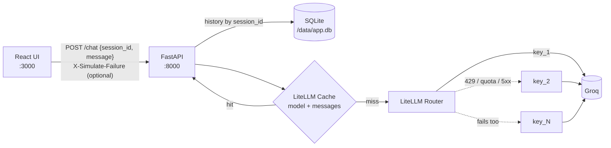

# LLM Chatbot with Key Failover and Response Caching

A full-stack chatbot. It keeps multi-turn context per session, fails over to the next API key automatically when a provider returns 429, a quota error or a 5xx, and serves repeated requests from LiteLLM's response cache. Each reply shows where it came from, the model that answered, the latency and the tokens used by that request.

| Tier | Tech |
| --- | --- |
| Frontend | React 19 + TypeScript (Vite), plain CSS |
| Backend | Python 3.13, FastAPI, LiteLLM `Router` + LiteLLM `Cache` |
| Storage | SQLite (standard library `sqlite3`) on a Docker volume at `/data/app.db` |
| LLM | Groq (`groq/openai/gpt-oss-120b`) through LiteLLM. Any LiteLLM provider works by changing `LLM_MODEL` |



---

## 1. Live URLs

| | URL |
| --- | --- |
| Frontend | [https://llm-chatbot-web.onrender.com](https://llm-chatbot-web.onrender.com) |
| Backend | [https://llm-chatbot-api-im3r.onrender.com](https://llm-chatbot-api-im3r.onrender.com/health) (try [`/health`](https://llm-chatbot-api-im3r.onrender.com/health)) |
| Repository | [https://github.com/aaryanrana01/resilient-llm-chatbot](https://github.com/aaryanrana01/resilient-llm-chatbot) |
| Demo video | `<link>` |

> The backend runs on Render's free tier, which sleeps after about 15 minutes without traffic. The first request after that can take around 30–50 s while it wakes up. The UI shows *Connecting…* until `/health` answers.

---

## 2. Run locally: with Docker and without

### With Docker (recommended)

Requirements: Docker Desktop (or Docker Engine with the Compose plugin) and `make`.

```bash
cp .env.example .env          # then put at least 2 real keys in LLM_API_KEYS
make up                       # builds both images and starts the stack
```

- Frontend: http://localhost:3000
- Backend: http://localhost:8000/health

| Command | What it does |
| --- | --- |
| `make up` | Build and start both services in the background. Creates `.env` from the example if it's missing. |
| `make down` | Stop the stack. The `app-data` volume, and with it the chat history, is kept. |
| `make logs` | Follow the logs of both services. |
| `make clean` | Stop the stack **and** delete the SQLite volume. |
| `make smoke` | Run the API contract smoke test against `http://localhost:8000` (or `make smoke API=https://...`). |
| `make test` | Run the backend and frontend tests. |

Images:
- `backend/Dockerfile` has two stages. A `python:3.13-slim` builder installs the dependencies into a virtualenv, and a slim runtime copies only that virtualenv and `app/`. It runs as a non-root user, has a healthcheck, and declares `/data` as a volume.
- `frontend/Dockerfile` has two stages. `node:22-alpine` builds the static files, and `nginx-unprivileged:alpine` serves them on port 3000. The backend URL is written into `/config.js` from the `API_BASE_URL` env var when the container starts, so one image works in every environment.

`docker-compose.yml` mounts the named volume `app-data` at `/data`, so `DATABASE_URL=sqlite:////data/app.db` survives `make down && make up` and container restarts.

### Without Docker

Backend (Python 3.12+):

```bash
cd backend
python3 -m venv .venv && source .venv/bin/activate
pip install -r requirements-dev.txt
export LLM_API_KEYS="gsk_key1,gsk_key2"
export DATABASE_URL="sqlite:///./data/app.db"
export ALLOWED_ORIGINS="http://localhost:3000"
export ENABLE_FAILURE_SIMULATION=true
uvicorn app.main:app --reload --port 8000
pytest                         # 60+ tests, no real API keys needed
```

Frontend (Node 20.19+ / 22):

```bash
cd frontend
npm ci
npm run dev                    # http://localhost:3000, talks to http://localhost:8000
# point it at another backend: VITE_API_BASE_URL=https://... npm run dev
npm test
```

### Environment variables

Every variable is listed in [`.env.example`](.env.example). The important ones:

| Variable | Meaning |
| --- | --- |
| `LLM_API_KEYS` | Comma-separated key pool, at least 2. Key ids are `key_1`, `key_2`, … in this order. |
| `LLM_MODEL` | LiteLLM model used by every key (default `groq/openai/gpt-oss-120b`). |
| `LLM_MODELS` | Optional model per key, e.g. `groq/openai/gpt-oss-120b,groq/openai/gpt-oss-20b`. |
| `DATABASE_URL` | SQLite location, e.g. `sqlite:////data/app.db`. |
| `ALLOWED_ORIGINS` | Comma-separated CORS origins (the frontend URL). |
| `ENABLE_FAILURE_SIMULATION` | `true` enables the `X-Simulate-Failure` hook. |
| `CACHE_TTL_SECONDS` | How long cached responses live (default 3600). |
| `MAX_HISTORY_MESSAGES` | How many earlier messages of the session are sent as context (default 40). |
| `API_BASE_URL` / `VITE_API_BASE_URL` | Frontend: backend URL at container start (Docker) or at build time (static hosting). |

---

## 3. Design decisions: key fallback, caching, SQLite session storage

### Request flow (`POST /chat`)

1. **Validate.** `session_id` must be 1–128 characters and not blank. `message` must be 1–4000 characters after trimming. Anything else, including malformed JSON, returns `422 {"detail": [...]}` before any work is done.
2. **Lock the session.** One `asyncio.Lock` per `session_id` means two requests in the same chat can't interleave their history. Different sessions run in parallel.
3. **Build the prompt.** The message list is the system prompt (the per-session override, otherwise the default), then the stored history from SQLite (the last `MAX_HISTORY_MESSAGES`), then the new message. The client only ever sends the new message.
4. **Cache lookup**, then **Router call** with ordered fallback (details below).
5. **Persist.** Only after a successful reply are the user message and the assistant message written, in one SQLite transaction. A 422 or 503 never leaves anything in the history.
6. **Respond.** `latency_ms` is measured on the server from the start of the request to the end of the save, rounded up to whole milliseconds.

### Key fallback with LiteLLM's Router

- Each key in `LLM_API_KEYS` becomes its own Router deployment, in a model group named after its id (`key_1`, `key_2`, …), with `model_info.id = key_N`.
- The Router is configured with `fallbacks=[{"key_1": ["key_2", …, "key_N"]}]`, `num_retries=0`, `max_retries=0` and `disable_cooldowns=True`. When a key raises a 429, a quota error, a 5xx, a timeout, a connection error or an auth error, LiteLLM moves to the next key immediately and in a fixed order. Retrying the same key isn't useful here, because the next key *is* the retry.
- The answering key comes from LiteLLM's `response._hidden_params["model_id"]`. The real key is never returned or logged.
- `fallback_attempts` is counted by a LiteLLM `CustomLogger` hook (`async_pre_call_deployment_hook`). It runs right before each key is tried, so the attempt count includes every failed key.
- If every key fails, the backend returns `503 {"detail": "all providers unavailable"}`. Unexpected exceptions are also turned into JSON (`500 {"detail": "internal server error"}`), so the user never sees a stack trace or an HTML error page.
- One edge case: a provider can answer `200` with an empty completion, which LiteLLM doesn't treat as an error. The gateway marks the keys it already tried as "skip" and asks the Router again, so the remaining keys still get their turn.

**Failure simulation.** `X-Simulate-Failure: key_1=429,key_2=500` (or `*=429`) is parsed into a per-request map. Statuses 429, 500, 502 and 503 are accepted, and bad entries are ignored and logged. The same pre-call hook checks that map and raises *the same LiteLLM exception class* a real provider error would produce (`RateLimitError`, `InternalServerError`, `BadGatewayError`, `ServiceUnavailableError`). That means simulated failures go through exactly the same Router fallback code as real outages. The map is attached only to that request, and cooldowns are disabled, so a simulated failure never affects the next request. The header is ignored unless `ENABLE_FAILURE_SIMULATION=true`.

Simulated requests skip the cache *read*. Without that, a cached message would come back as `LLM_CACHE` and failover wouldn't be visible. With it, the contract table always holds: `key_1=429` gives `200` from `key_2`, and `*=429` gives `503`.

### Caching with LiteLLM's Cache

- LiteLLM's built-in in-memory `Cache(type="local")`, with a TTL set by `CACHE_TTL_SECONDS`.
- **Cache key** is LiteLLM's own `get_cache_key(model=…, messages=…)`, a hash of the model plus the *full* message list (system prompt, history and new message). So:
  - the same first message in a new session is a hit (same system prompt, empty history, same text);
  - any difference in the text, the history or the system prompt is a miss. A different message never comes from the cache.
- The lookup happens **before** the Router is called. A hit makes no provider request, so it returns `resolution_source: "LLM_CACHE"`, `key_id: null`, `fallback_attempts: 0`, the identical reply text, and the token usage stored with the original response. It typically takes about 1–5 ms, compared with hundreds of ms for a live call.
- The cache sits in front of the Router rather than inside it. Router-level caching keys on the model *group* (`key_1`, `key_2`), which would keep one copy per key and would always try `key_1` first. An explicit lookup keyed on the real model name avoids both problems and matches the contract (*model + messages*) exactly.

### Token accounting

`input_tokens` and `output_tokens` are the provider's `usage.prompt_tokens` and `usage.completion_tokens` for **this request only**. Input tokens grow with the history because the history is part of the prompt, but they are never summed across turns. If a provider omits usage, `litellm.token_counter` is used as a fallback.

### SQLite session storage

- Standard-library `sqlite3`, WAL mode, a single connection guarded by a lock. Calls run in a worker thread so they never block the event loop.
- The schema is created automatically on startup (`CREATE TABLE IF NOT EXISTS`):
  - `messages` follows the minimal model from the brief, plus a `CHECK` on `role` and an index on `(session_id, id)`.
  - `sessions (session_id, system_prompt, created_at, updated_at)` stores each session's system-prompt override.
- Timestamps are server time in ISO-8601 UTC. `metadata` is JSON and is only set on assistant messages.
- `GET /sessions/{id}/messages` returns the history oldest first, without the system prompt. It returns 404 `{"detail": "session not found"}` for an unknown id.
- With Docker the file lives on the named volume `app-data:/data`, so history survives container restarts.

### Frontend

- A new `session_id` (`s-<random>`) is generated on every page load. *New chat* starts another one.
- The textarea (`chat-input`) is cleared as soon as a message is sent. Enter sends and Shift+Enter adds a new line.
- Each `assistant-message` holds the reply plus `meta-source`, `meta-model`, `meta-latency` (`812 ms`), `meta-input-tokens` and `meta-output-tokens`. It also shows the key and the failover count.
- 422, 503 and network errors appear as readable messages in the chat, with a Retry button. The failed user message is marked "not saved".
- The backend URL is resolved in this order: runtime `/config.js` (Docker), then `VITE_API_BASE_URL` (static hosts), then `http://localhost:8000`.

---

## 4. Verification: how to see failover, cache hits and per-message token usage

Set `API=http://localhost:8000` (or the deployed backend URL).

**Health**

```bash
curl -s $API/health
# {"status":"ok","keys_configured":2,"cache_enabled":true}
```

**Cache hit.** Send the same first message in two new sessions:

```bash
curl -s -X POST $API/chat -H 'Content-Type: application/json' \
  -d '{"session_id":"demo-1","message":"What is the capital of France?"}'
# "resolution_source":"LIVE_INFERENCE", "key_id":"key_1", "latency_ms": ~400

curl -s -X POST $API/chat -H 'Content-Type: application/json' \
  -d '{"session_id":"demo-2","message":"What is the capital of France?"}'
# "resolution_source":"LLM_CACHE", same reply, "key_id":null, "latency_ms": ~2
```

In the UI, send a message, reload the page (new session) and send the same message again. The badge turns green and shows `LLM_CACHE`.

**Failover**

```bash
curl -s -X POST $API/chat -H 'Content-Type: application/json' -H 'X-Simulate-Failure: key_1=429' \
  -d '{"session_id":"demo-3","message":"Hello!"}'
# 200, "key_id":"key_2", "fallback_attempts":1

curl -s -i -X POST $API/chat -H 'Content-Type: application/json' -H 'X-Simulate-Failure: *=429' \
  -d '{"session_id":"demo-4","message":"Hello!"}'
# HTTP/1.1 503  {"detail":"all providers unavailable"}

curl -s $API/sessions/demo-4/messages
# 404 {"detail":"session not found"}  -> the failed request was not stored
```

In the UI, pick a preset in **Failover simulator** (for example *key_1 → 429*) and send a message. The reply shows `key key_2` and a highlighted `failovers 1`. With *every key → 429* the chat shows a readable 503 message.

To see a **real** failover with no simulation, put an invalid key first: `LLM_API_KEYS=gsk_invalid,gsk_real_key`. Every reply then comes from `key_2` with `fallback_attempts: 1`.

**Per-message token usage.** Every reply shows `in` and `out` for that request only. In one session the `in` value grows (the history is part of the prompt) while `out` reflects only that reply. Two equal-length first messages in two new sessions report about the same `input_tokens`.

**Multi-turn and history**

```bash
curl -s -X POST $API/chat -H 'Content-Type: application/json' -d '{"session_id":"demo-5","message":"My name is Aaryan."}'
curl -s -X POST $API/chat -H 'Content-Type: application/json' -d '{"session_id":"demo-5","message":"What is my name?"}'
curl -s $API/sessions/demo-5/messages
```

**Validation**

```bash
curl -s -X POST $API/chat -H 'Content-Type: application/json' -d '{"session_id":"x","message":"   "}'   # 422
curl -s -X POST $API/chat -H 'Content-Type: application/json' -d '{"session_id":"x","message": '      # 422 malformed JSON
```

**Automated checks**

- `make smoke API=$API` runs 12 contract checks (health, live, cache, multi-turn, history, failover, 503, 422 ×3, 404) against any running backend.
- `cd backend && pytest` runs 60+ tests. They exercise LiteLLM over real HTTP against a small fake OpenAI-compatible provider (`tests/fake_provider.py`) that returns 429, quota, 5xx, 401 or empty responses depending on the key. Real error mapping and Router fallback are tested this way, not mocked. Persistence across restarts, CORS, the schema and key secrecy are covered too.
- `cd frontend && npm test` checks the `data-testid` contract, input clearing, error rendering and the simulation header.

---

## 5. Setup Used

- **Editor:** VS Code on macOS
- **AI tools:** Claude (Anthropic) as a coding assistant for scaffolding, tests and documentation. Every design decision above was reviewed and verified with the test suite and the smoke test.
- **Other:** Docker Desktop, GitHub Actions (CI), Render (hosting), Groq free tier (LLM keys)

---

## 6. Bonus features (if any)

| Feature | Why |
| --- | --- |
| **Failover simulator in the UI.** A dropdown adds `X-Simulate-Failure` to requests, with a warning banner while it's on. | Failover can be demonstrated from the browser, not only with curl. |
| **Key and failover count on every reply** (`key_id`, `fallback_attempts`), plus a session summary of replies, cache hits and failovers. | You can see which key answered without opening dev tools. |
| **Per-key models** (`LLM_MODELS`) | The pool can span several models, or several providers, with no code change. |
| **Empty-completion failover** | A `200` with no text is treated like a failure and the next key is tried, so the user never gets a blank reply. |
| **Per-session request lock** | Two quick messages in the same chat can't interleave or corrupt its history. |
| **Bounded context window** (`MAX_HISTORY_MESSAGES`) | Long chats don't grow past the model's context limit or the free-tier token quota. |
| **Contract smoke test** (`scripts/smoke_test.sh`, `make smoke`) | One command checks a deployed backend against the whole API contract. |
| **Tests over real HTTP** with a fake provider | LiteLLM's real error mapping and fallback are tested, not mocked. |
| **Runtime frontend config** (`/config.js` written at container start) | One frontend image works for any backend URL without rebuilding. |
| **Hardening:** non-root containers, healthchecks, API docs off by default, 422 bodies don't echo the input, keys never logged | A safer, more production-like default. |
| **CI** (`.github/workflows/ci.yml`) | Backend tests, frontend tests and build, and a `docker compose` boot check on every push. |
| **Render Blueprint** (`render.yaml`) | Both tiers deploy from one file. |
| **Formatted replies**: bold, lists, code blocks and tables are rendered by a small built-in Markdown renderer that never injects raw HTML | Model answers are easy to read, and model output can't run scripts in the page. |
| **Responsive UI with dark mode**, keyboard friendly, `aria-live` thread | Works on phones and with screen readers. |

### Known limitations

- The response cache is in memory (LiteLLM's `local` cache; this LiteLLM version has no disk backend). It is per process and resets on restart. Chat history is in SQLite and persists.
- Render's free web services have no persistent disk. On the deployed backend the SQLite file lives inside the container and resets on redeploy or after the service sleeps. Locally with Docker it persists on the `app-data` volume. On a host with volumes (Railway, Fly.io, or a paid Render disk mounted at `/data`), the same image persists with no change.
- Groq rate limits apply per account (organization), not per key. For failover to add capacity, the two keys should come from two different Groq accounts.
